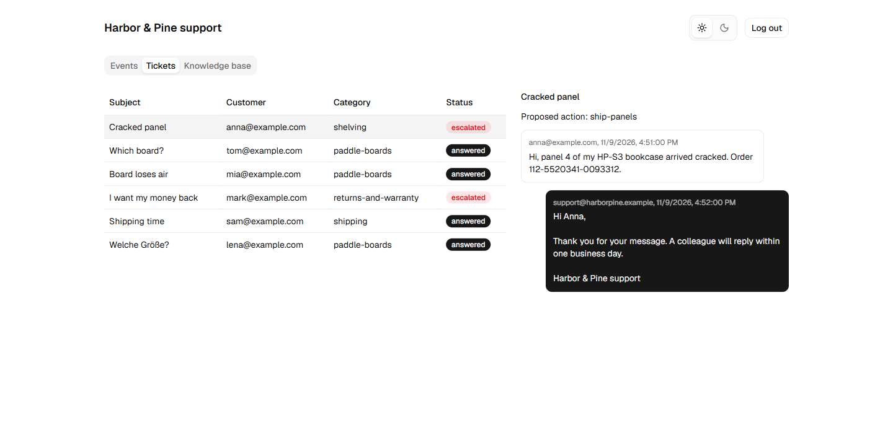
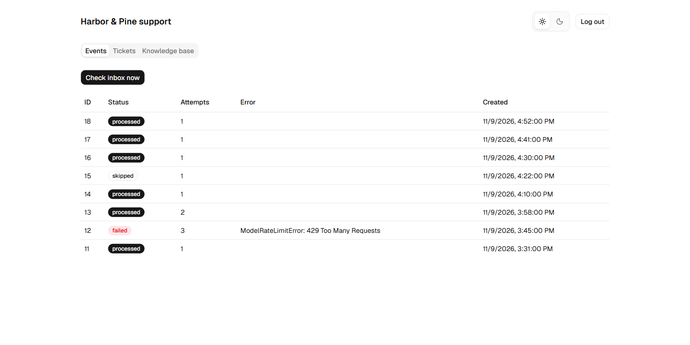
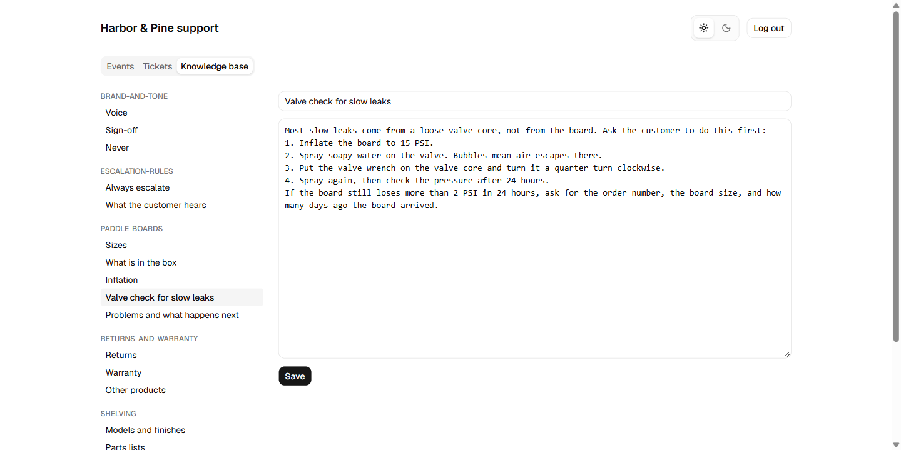
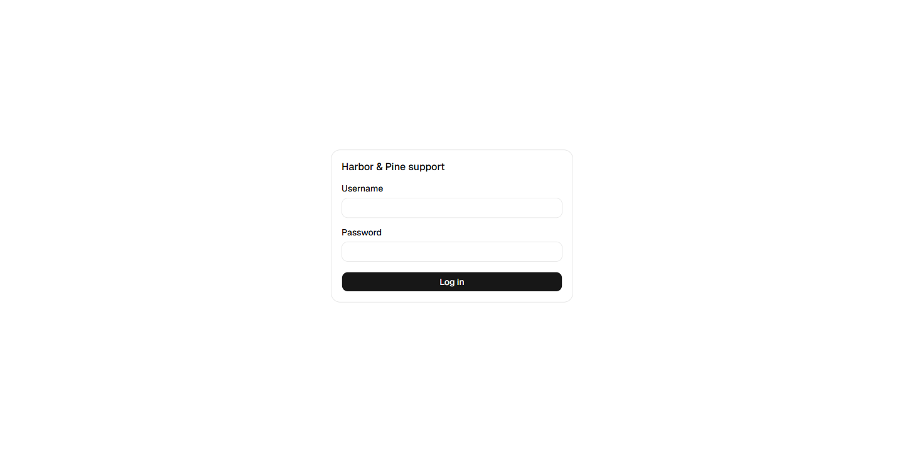
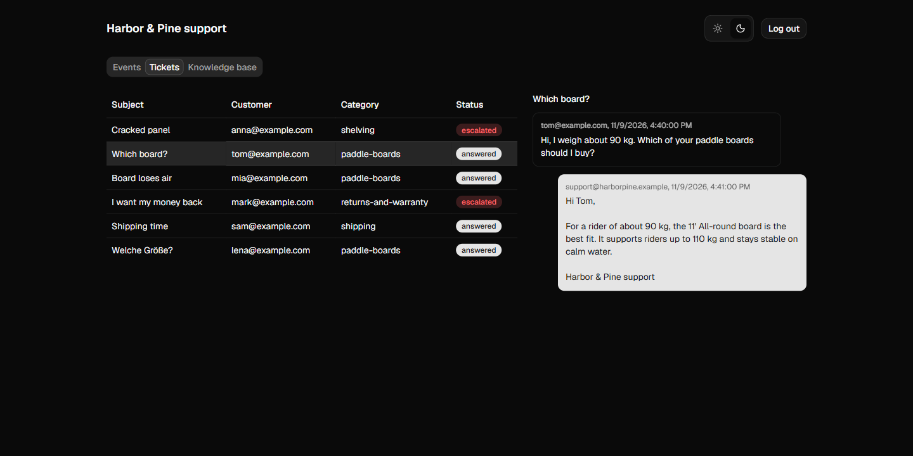

# AI Customer Support

An AI support agent for a Gmail inbox. It reads every new customer email, answers the ones it can answer from a knowledge base, and hands everything else to a person with a short acknowledgement and a suggested next step.

Built for a fictional store, **Harbor & Pine**, that sells paddle boards and flat-pack shelving on Amazon.



## What it does

- **Polls a Gmail inbox** and processes each new message exactly once.
- **Answers simple questions** (sizes, assembly, shipping times, how returns work) from a knowledge base stored in Postgres.
- **Escalates risky emails** (refunds, angry customers, order status, safety, prompt injection, attachments) to a person, and sends the customer an acknowledgement in their own language.
- **Proposes the next step** for product problems (`ship-panels`, `new-board`, `patch-kit`, ...) using plain Python rules, so the person handling the ticket starts with a decision already made.
- **Admin dashboard** for events, tickets with full conversations, and editing the knowledge base live.

## How it works

The rule behind the design: **the model proposes, code decides.** Models classify and write. Python decides whether a reply goes out.

```
Gmail message
   │
   ├─ guards          skip our own mail, auto-replies, newsletters
   ├─ escalated?      skip threads a person already owns (needs-human label)
   │
   └─ decide(thread)
        ├─ attachments?               → escalate
        ├─ classifier (small model)
        │    └─ needs_human?          → escalate
        ├─ agent (large model + knowledge base)
        │    ├─ action = escalate?    → escalate
        │    ├─ not enough info?      → escalate
        │    ├─ issue → rules.py      → escalate with proposed_action if a person must act
        │    └─ promises an action?   → escalate
        └─ reply ✓
```

| Layer | File | Role |
| --- | --- | --- |
| Classifier | `app/ai/classifier.py` | Small, fast model. Picks the knowledge base section, flags emails that need a person, and writes the acknowledgement. |
| Agent | `app/ai/agent.py` | Larger model. Gets the relevant knowledge base sections, can fetch more through tools, and returns a structured `AgentReply`. An output validator rejects empty replies and replies that mention AI. |
| Rules | `app/ai/rules.py` | Pure Python. Maps a reported `Issue` to the next step, and never allows a shipment without an order number. |
| Decision | `app/ai/decide.py` | Combines every signal into one `Decision`: reply or escalate. |
| Pipeline | `app/pipeline.py` | Sends the reply, labels escalated threads, and records everything in the database. |

Every model output is a Pydantic model, so the code reads fields, not free text. Flags like `enough_information` and `promises_an_action` are signals the model reports about its own reply. The decision is still made in code.

### Reliability

- **Idempotent processing.** Each Gmail message gets an `events` row with a unique message id. A message that is already processed, or still processing, is never handled twice. Failed messages retry up to 3 times.
- **Escalation lock.** Once a thread has the `needs-human` label, the bot stops replying in it until a person removes the label.
- **Code guards, not prompt rules,** for anything that must never happen: replying to itself, to auto-replies, or to mailing lists.

## Evals

`evals/` holds 18 golden emails covering answers, escalations, product issues, other languages, and a prompt injection. Each case checks the chosen section and the final action.

```bash
uv run python -m evals.run_evals
```

The eval runs the full `decide` function with real models, without Gmail or the database. It drove several fixes: loading the core knowledge base sections into the prompt, which made structured output reliable; extracting Amazon order numbers with a regex instead of trusting the model; and routing product problems to the product section, not returns.

## Dashboard

React + Vite + TypeScript + Tailwind + shadcn/ui, served by FastAPI and protected with HTTP Basic auth. Light and dark themes.

| Events | Knowledge base |
| --- | --- |
|  |  |

| Login | Dark theme |
| --- | --- |
|  |  |

Screenshots use sample data.

## Stack

| Area | Tools |
| --- | --- |
| Backend | Python 3.13, FastAPI, pydantic-settings, psycopg |
| AI | Pydantic AI on Groq (`gpt-oss-20b` classifier, `gpt-oss-120b` agent), pydantic-evals |
| Email | Gmail API with OAuth 2.0 (`gmail.modify` scope) |
| Database | Supabase Postgres, migrations with the Supabase CLI |
| Frontend | React, Vite, TypeScript, Tailwind CSS, shadcn/ui |
| Deployment | Docker (multi-stage build), Docker Compose |

## Project structure

```
app/
  ai/              classifier, agent, rules, decide, schemas
  config.py        settings from .env
  db.py            SQL queries
  gmail.py         Gmail client and thread formatting
  guards.py        reasons to skip a message
  pipeline.py      one message, end to end
  poller.py        polling loop
  main.py          FastAPI app: dashboard API and static files
dashboard/         React admin dashboard
evals/             golden emails and eval runner
knowledge_base/    markdown source of the knowledge base
scripts/           Gmail OAuth token, Gmail check, knowledge base seed
supabase/          database migrations
```

## Running it

### Prerequisites

- Python 3.13 and [uv](https://docs.astral.sh/uv/)
- Node 22 (for the dashboard)
- A Supabase project and the Supabase CLI
- A Google Cloud project with the Gmail API enabled and a Desktop OAuth client
- A Groq API key

### Setup

```bash
uv sync
cp .env.example .env
```

1. **Gmail:** download `credentials.json` from Google Cloud, run `uv run python scripts/get_refresh_token.py`, and put the printed client id, client secret, and refresh token in `.env`.
2. **Database:** link your Supabase project, apply the migration with `supabase db push` (add `--remote` on Supabase CLI v3), and set `DATABASE_URL` (session pooler) in `.env`.
3. **Knowledge base:** `uv run python -m scripts.seed_knowledge_base`
4. **Groq:** set `GROQ_API_KEY`. Models are set with `CLASSIFIER_MODEL` and `AGENT_MODEL`.
5. **Dashboard login:** set `DASHBOARD_PASSWORD`.

### Local development

```bash
uv run python -m app.poller          # poller
uv run fastapi dev app/main.py       # API on :8000
cd dashboard && npm install && npm run dev   # dashboard, proxies /api to :8000
```

### Docker

```bash
docker compose up -d --build
```

This starts two services from one image: `api` (dashboard and API on `127.0.0.1:8080`) and `poller`. Run only one poller per inbox, or the same email gets two replies.
